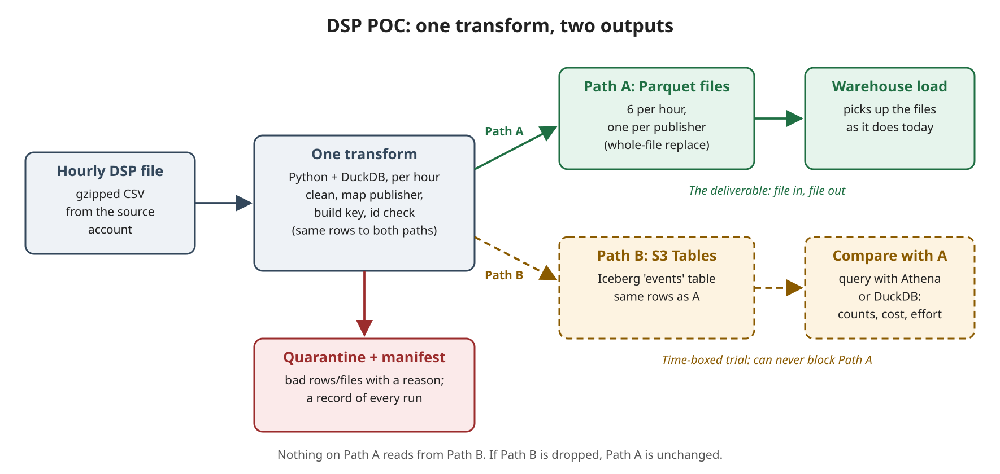

| | |
|---|---|
| **Author** | Paul Guidry |
| **For** | Jesse Read, Scott Clair; FYI Cillian Kennedy, David Powell, Jeff Knight |
| **Jira** | DTE-151 (DSP v1 pipeline POC); HLD DTE-152 |
| **Status** | ROUGH DRAFT for discussion. Items marked **[TBD]** are open. |
| **Diagrams** | `dsp-poc-hld-2026-10-28.drawio` (HLD, with the workflow sequence diagram underneath) |

## 1. Summary

By Monday 11/02, the DSP v1 pipeline will run end to end in the sandbox. Every hour it takes one gzipped DSP file and produces one clean Parquet file per publisher: keyed, de-duplicated, with bad rows quarantined in the team's existing format. That is the deliverable (**Path A**), and it becomes the pipe version on 11/07.

Alongside it, the same rows are written to an S3 Tables (Iceberg) table (**Path B**), so the team can judge S3 Tables on real data, as Jesse asked on 10/23. Path B is time-boxed and can never block Path A: there is one transform and two writers, and nothing on A's path reads from B.

The DSP-specific logic lives inside the transform and won't carry over to other feeds. What the POC really tests is everything around it: trigger, lock, fan-out, safe writes, replays, manifest and quarantine, plus a fair storage comparison. If it works, the team gets a candidate template for its other scheduled, file-based feeds.

| Milestone | Date | What it is |
|---|---|---|
| Internal goal | Fri 10/30 | POC running end to end |
| POC demo | Mon 11/02 | This document's scope |
| Pipe version | Fri 11/07 | Tweaked, production-shaped |
| Final delivery | Mid-November | DSP data in the warehouse (Scott's Slice-to-warehouse migration) |

## 2. Why the DSP matters now

- **It's a priority for the business.** EHR is a big part of the business, and the DSP diversifies supply (Scott, 10/27).
- **The calendar is tight.** About 150 EHR campaigns renew in roughly six weeks, clients are hard to reach from mid-November, and DSP data is due in the warehouse by mid-November (Scott, 10/14 and 10/27).
- **Growth.** EHR projects 20 to 25% more volume next year (Scott, 10/27).
- **One schema going forward.** A column should mean the same thing for every vendor (Scott, 10/20). A clean, keyed contract is the first step.

## 3. The problem today, with examples from the data

All figures are from the raw DSP files (40,319,181 rows, September 2024 to October 2026), using the queries in the key spec (DTE-132) and the transaction-id verdict.

| Problem | Example from the data | Why it matters |
|---|---|---|
| No agreed row key | 18 publisher labels for 6 real publishers (for example "Veradigm" and "[EHR] Veradigm"). Without mapping, one event can produce two keys. | Duplicates reach the warehouse. |
| Transaction ids are reused | 87 ids appear under more than one publisher, 1 to 278 days apart, and they carry different NPIs. One Veradigm id was reused by a blank-publisher row about 9 months later. | A per-file or per-publisher check misses them. The check has to see the whole history. |
| Double-fires | 7,270 of 7,357 repeated ids are same-millisecond repeats. | Exact duplicates must collapse, not double-count. |
| Uneven publishers | Relevate Games is 57% of kept rows (445,602) and Office Ally 14% (108,794). Practice EHR has 43 rows in two years. | The pipeline must handle both extremes, including hours with no rows for a publisher. |
| Noise in the feed | Test Account and blank-publisher rows (blank rows are all historical; the last is 2026-01-27). September 2026 is 99.28% kept publishers. | Must be dropped by rule, not by hand. |
| No quarantine for the DSP | Bad rows have no standard place to go today. | Problems are invisible instead of counted with a reason. |

## 4. What was asked for

The POC is built from what Jesse and Scott asked for, not from a favorite pattern.

| Asked | By, when | How the POC answers it |
|---|---|---|
| Hourly gzipped CSV in; one Parquet file per publisher out; check duplicate ids; syntactic cleanup | Jesse, 10/23 | Path A, exactly |
| "Play with S3 Tables along the way ... see if we like it" | Jesse, 10/23 | Path B, time-boxed |
| Must originate from the heartbeat | Jesse, 10/23 | Scheduler stand-in for the POC; one-line heartbeat change after Jesse reviews it |
| Step Function handles the lock; discard if still running (Cillian's Glue pattern) | Jesse, 10/23 | `CheckLock` state, 25-minute timeout |
| No separate job state; use the manifests | Jesse, 10/23 | "Done" = output files exist + manifest entry |
| Replay replaces the whole file | Jesse, 10/23 and 10/26 | Temp key, then copy over the final key |
| Quarantine with a reason, in the standard format, not a new data store | Jesse, 10/26 and 10/27 | Team's manifests and `failed-keys/` (sandbox copy) |
| Avoid MWAA | Jesse, 10/23 | Not used |
| Historical load on a tag, not in the active code | Jesse, 10/23 | Backfill as a separate state machine; one week for the POC |
| Hourly, time-based trigger (a missing file is easy to see) | Scott, 10/27 | EventBridge Scheduler, hourly |
| Iceberg is "not a don't do it", but time-box it; fast simple path first if it lags | Scott, 10/27 | Path B time-box and stop rule (section 10) |

## 5. What the POC is

One pipeline, one transform, two writers.

{width=6.5in}

1. Once an hour, EventBridge Scheduler (stand-in for the Node heartbeat) starts a Step Function.
2. The Step Function checks the lock, finds hours that aren't done yet (up to 6 per run), and runs each one through the transform, two at a time.
3. The transform (container Lambda, Python + DuckDB) reads the file, validates the header, records every row's id in an id ledger, collapses exact duplicates, runs the dataset-wide id check, drops Test Account and blank-publisher rows, maps the labels to 6 publishers and builds the key.
4. **Writer A** writes one Parquet file per publisher, first. **Writer B** writes the same rows to S3 Tables, second. If B fails, A is unaffected.
5. Bad rows go to quarantine with a reason code; every hour gets a manifest entry.

See the HLD and the workflow sequence diagram in `dsp-poc-hld-2026-10-28.drawio`.

## 6. Why these two paths

**Path A is the "do it easy" path.** It is file in, file out, Parquet, whole-file replacement: the shape the warehouse already reads. Jesse's caution on 10/26 ("be intentional with where we experiment ... do we just do it easy?") is exactly why A stands on its own.

**Path B is evidence for a decision the team already plans to make.** Jesse said on 10/20 that there will be a data lake, and the choice between S3 Tables, Iceberg managed in-house, or Snowflake is a conversation for "after you guys build your first couple pipelines". Path B gives that conversation real numbers. Because the transform is shared, B costs one extra writer, not a second pipeline.

**Why build them together.** The comparison is only fair if both sides get identical input and logic. Building B later would mean re-running the transform and arguing about differences that have nothing to do with storage.

**Why serverless (Step Functions + Lambda).** The work is a bounded, repeatable unit (one file-hour) on a schedule with no state between runs. Step Functions gives the lock, retries and run history that would otherwise be hand-built, and a backfill fans out without a cluster. It also fits the direction Jesse set on 10/23: after this pipeline, "get off the single node runtime"; the monolith "can't stay a monolith forever".

### Alternatives considered

| Option | Why not (for this POC) |
|---|---|
| Node heartbeat shells out to DuckDB on the EC2 | Fastest to stand up, and Jesse said the EC2 has room. But the lock, retries and run history would be hand-built, and it ties the work to the single node. **Kept as the fallback** (section 9). |
| MWAA (managed Airflow) | Jesse: conflicts with the current cron runner. |
| Airflow first | Orchestration is the part that affects everyone; it shouldn't lead (Jesse to David, 10/26-27). This POC plugs into the existing heartbeat instead of replacing it. |
| dbt | A model graph for warehouse-side SQL; it doesn't handle the trigger, lock, manifest or quarantine. Fits downstream, not here. |
| Glue / Spark | More machinery than hourly files of this size need. |

## 7. Addressing the concerns up front

| Concern | Answer |
|---|---|
| "File in, file out; you're not building a data lake" (Jesse, 10/23) | Path A is file in, file out. Path B is a separate, time-boxed trial branch that A never reads from. |
| "Be intentional with where we experiment" (Jesse, 10/26) | The experiment is one writer with a time-box and a stop rule. Dropping it costs A nothing. |
| "What you're working on now will not transfer" to the new DSP (Jesse, 10/21) | Agreed for the DSP-specific parts: parsing, cleanup, key rules and schema are for the current feed only, and nothing in the POC anticipates AdKernel. What can transfer is the mechanism around the transform (table below), for the team's other scheduled, file-based feeds. |
| Iceberg's benefits show up at terabyte scale with upserts, not on 4 MB files (Jesse, 10/27) | Agreed. B isn't about speed at today's size. It's the first real evidence on S3 Tables for our batch pipelines, one input into the data-lake decision, not the decision itself. |
| Like-for-like: single-digit shifts in the top metrics are a big business change (Jesse, 10/27) | A passes data through: no NPI filtering for 1.5, no bot filtering. A success criterion is that A's row counts reconcile with the raw files, with every difference explained by a quarantine reason or a documented drop rule. |
| Orchestration affects everyone | The POC fits the existing heartbeat and reuses the team's manifest, quarantine format and lock pattern. Adopting it as a template is the team's decision; the POC provides the evidence. |

### What transfers and what doesn't

| Transfers (candidate template for scheduled, file-based feeds) | Doesn't transfer (DSP-specific, inside the transform or its config) |
|---|---|
| Trigger from the heartbeat / scheduler | File parsing and header validation |
| Lock and timeout | Cleanup rules |
| Find work from output files + manifest | Publisher mapping (9 labels to 6) |
| Fan-out, one unit of work per invocation | Key rules (D1-D12) and the id ledger contents |
| Safe writes (temp key, then final key) and whole-file replays | Output schema |
| Manifest and quarantine in the team's format | Which checks apply |
| Storage comparison results (Parquet vs S3 Tables) for batch feeds | |

Not covered by the template: streaming feeds such as the new DSP's full avails stream, which Scott expects to get its own streaming solution.

## 8. Assumptions

| # | Assumption | If it's wrong |
|---|---|---|
| A1 | The largest hour finishes in Lambda in under 5 minutes. Phase 0 measures this first. | The same container image runs on Fargate. No redesign. |
| A2 | Key spec D1-D12 holds (DTE-132, awaiting Jesse's sign-off). | Rule changes are edits inside the transform. |
| A3 | Six output files per hour, one per publisher. Jesse's 10/23 example had three. | The publisher list is a config file: 6 to 3 is a config change. Need to know what happens to Relevate Games (57%) and Office Ally (14%) if it's 3. |
| A4 | The dataset-wide id check looks at full history. | The window is a config value; shrink it once the archive and warehouse retention questions are answered. |
| A5 | Enrichment is a pass-through stub until Cillian's factory endpoint is ready. | The transform calls enrichment through one interface; swapping the stub is contained. |
| A6 | The POC reads a curated copy of the DSP files in the sandbox until cross-account access (DTE-147) is granted. | A true end to end waits on DTE-147; everything else is unaffected. |
| A7 | A Python Lambda is acceptable next to the Node service. | Fallback is the EC2 shell-out. |
| A8 | Parallel hours don't hide id reuse. Two hours run at once, so the id check runs once per batch of hours (or one at a time for that step). | Proposed; to confirm during Phase 3. |

## 9. Path A: the Parquet contract

**Purpose.** Prove the v1 contract works end to end: an hourly DSP file becomes clean Parquet per publisher, with the agreed key, quarantine and replays, on an hourly schedule. This becomes the 11/07 pipe version.

**What it does, for one hour.** **[TBD: worked example from a real hour in the sandbox: rows in, exact duplicates collapsed, quarantined by reason, dropped by rule, rows out per publisher, files written.]**

**Success (each pass/fail):**

- [ ] The largest hour finishes in under 5 minutes in Lambda, or the Fargate route works.
- [ ] One correct Parquet file per publisher per hour, matching the agreed output schema **[TBD: output schema draft, for Jesse and team to review]**. Empty hours produce an empty file, not a missing one.
- [ ] Rerunning an hour gives identical output, with no duplicates.
- [ ] An overlapping trigger is discarded, never run twice.
- [ ] Duplicates, id conflicts and reused ids are counted and quarantined with reasons, in the team's format.
- [ ] The dataset-wide id check runs against the full history (~40M ids) within the time target.
- [ ] Row counts reconcile with the raw files, and every difference has a quarantine reason or a drop rule.
- [ ] DSP-specific settings (publisher list, checks, output layout) live in config, not in the orchestration.

**Failure, and what happens then.** Path A fails if the contract can't be produced reliably by 11/07: wrong or missing files, non-repeatable reruns, or runtime the hourly cadence can't absorb. Fallback: the same transform runs from the Node heartbeat on the EC2 (Jesse OK'd that route on 10/23), so the contract still ships.

## 10. Path B: the S3 Tables trial

**Purpose.** Decide whether the team likes S3 Tables, using the same input and logic as A, so storage is the only difference.

**What it does.** Writes the same rows as A into one `events` table (partitioned by publisher and day, proposed), replacing the rows for a source file on replay, to match A's whole-file rule. `raw_events` and a lake quarantine view come only if the team keeps Iceberg.

**What we measure (filled in during the POC):**

| Measure | Parquet files | S3 Tables |
|---|---|---|
| Write time per hour (s) | | |
| Files written per day | | |
| Query time, one day, DuckDB (s) | | |
| Query time, one day, Athena (s) | | |
| Steps to replay one hour | | |
| Maintenance code needed | | |
| Storage cost per month (USD, estimate) | | |
| Readable by the warehouse as-is | | |

Plus: S3 Tables holds exactly the same rows as the Parquet files for every hour loaded.

**Success.** The table is filled in with real numbers, the row counts match A for every hour, and the team has enough to say keep, drop, or revisit at larger scale.

**Reasons to drop it.** It threatens A's dates; replays can't match the whole-file rule cleanly; the maintenance burden is out of proportion to the benefit at this size. Dropping B costs A nothing.

**Time-box and stop rule.** **[TBD: Paul's estimate for Scott.]** Proposed rule: if B isn't writing rows that match A by end of day Thu 10/29, it comes out of Monday's demo, A ships alone, and B resumes only after 11/07 if Scott and Jesse want it.

## 11. Why it's worth doing

- **The deliverable is needed regardless.** The DSP has to reach the warehouse by mid-November, keyed and clean. Path A is that work.
- **Even if B is dropped,** the team gets: a working contract for the current feed; the first real numbers on S3 Tables for batch pipelines; and a tested pattern for lock, fan-out, replays, manifest and quarantine outside the single-node runtime.
- **Low risk.** Sandbox only: no production buckets, no changes to the Node service, no reads from the enrichment database. Everything is defined as code, prefixed `dsp-poc-` and tagged.
- **Built on what the team already uses:** the manifest format, the quarantine format, Cillian's lock pattern, the 21-day lookback and the heartbeat.
- **Cost.** **[TBD: AWS estimate. Expected to be small at POC volume: about 14 scheduled runs a day (sandbox hours, weekdays), a few GB in S3; the sandbox already stops nightly.]**

## 12. Not in scope for Monday

- Node heartbeat change (the POC uses a scheduler stand-in; the change comes after Jesse and team review it)
- Real enrichment (stub until Cillian's endpoint is ready)
- Full historical backfill (one week only, to prove fan-out and replays)
- Monthly roll-up of the id ledger (added for the 11/07 pipe version)
- Whole-file rejection threshold (row-level quarantine only until the threshold is agreed)
- NPI validation, bot filtering, restatement handling (key spec D8, D9, D11)
- A wider Iceberg lake (`raw_events`, a lake quarantine view)
- Anything for the new DSP (AdKernel) or its avails stream

## 13. Decisions made and open questions

**Decided (Paul, 10/27):** one transform, two writers, A first; id history from a ledger on A's side, window configurable, default full history; six output files per hour from a config list, every publisher every hour; the lake holds `events` only; quarantine stays in the team format.

**Open (none block Monday; each is a labelled assumption until answered):**

| Question | Who |
|---|---|
| Six publisher files, or three? If three, what happens to Relevate Games and Office Ally? | Jesse and team |
| Age-based archive: how long does DSP data stay active? (sets the id-check window) | Jesse and team |
| How long does Redshift keep DSP history, and does it treat the key as unique? | Jesse and team |
| Id check scope (O1): quarantine only kept-publisher rows, checked against all rows? | Jesse and team (Cillian) |
| Id conflicts (O2): quarantine both rows or only the later one? (Scott's view differs from D4) | Jesse and team (Cillian) |
| Whole-file reject threshold (Scott floated ~0.5%) | Jesse and team |
| Who raises reused ids with the vendor, and what should the pipeline report? | Jesse, Scott |
| Python Lambda OK next to the Node service? | Jesse and team |
| Cross-account read on the source bucket (DTE-147) | Jesse and team |

## 14. Next steps after the demo

1. **Mon 11/02:** demo a scheduled run live, then the pass/fail list and the comparison table.
2. **By Fri 11/07 (pipe version):** fold in Jesse's and Scott's feedback and the answers above; add the ledger roll-up; heartbeat change if approved; keep or drop B.
3. **Mid-November (final):** hand over, with the runbook, and point the warehouse at the contract output.

## Appendix: sources

- Meeting transcripts: standups 2026-10-20, 10-23, 10-26, 10-27; Scott 1:1s 2026-10-20 and 10-27; Jesse's email of 2026-10-21 ("Programmatic DSP Timeline"). Quote-by-quote notes with times: `dsp-poc-proposal-evidence-2026-10-28.md`.
- Data: DSP row key specification (`dsp-key-spec-2026-10-27`, DTE-132), queries K1-K2; `transaction-id-verdict-2026-10-20`; `status-followups-2026-10-21`.
- Design: `dsp-poc-what-monday-delivers` (Claude Doc); HLD and sequence diagram `dsp-poc-hld-2026-10-28.drawio`.
